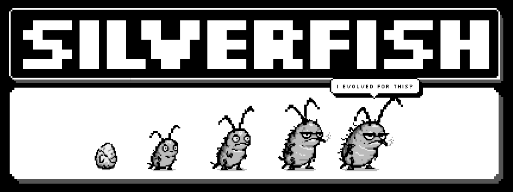
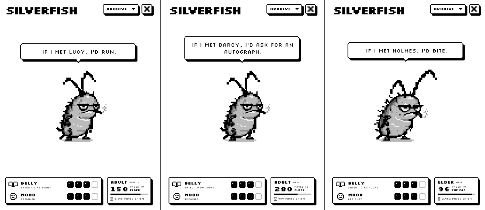
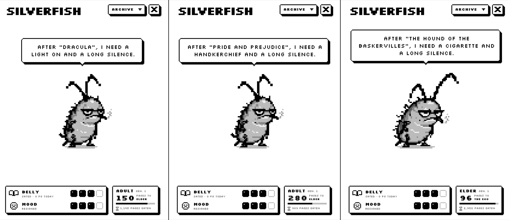
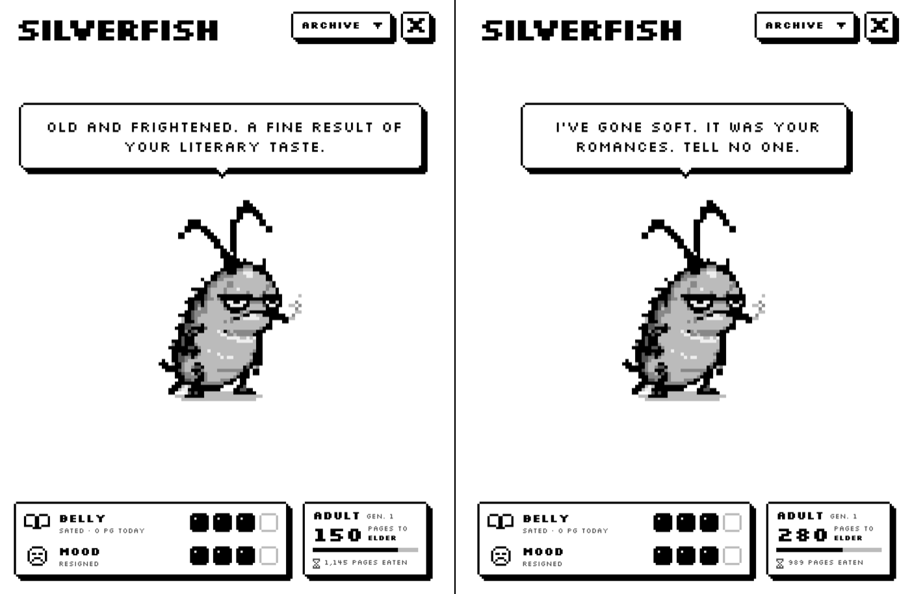
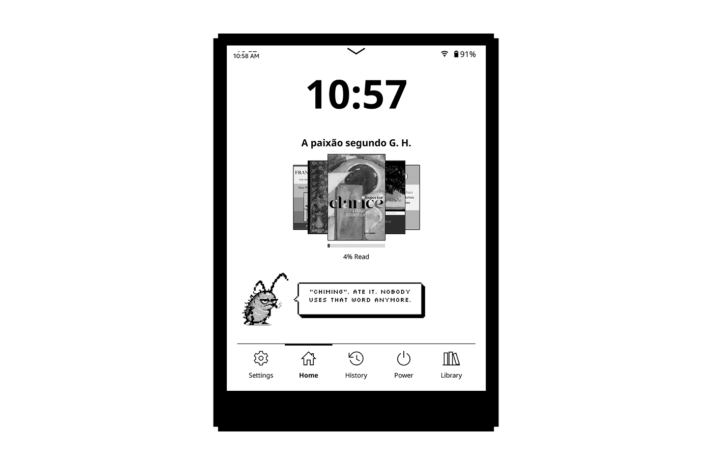
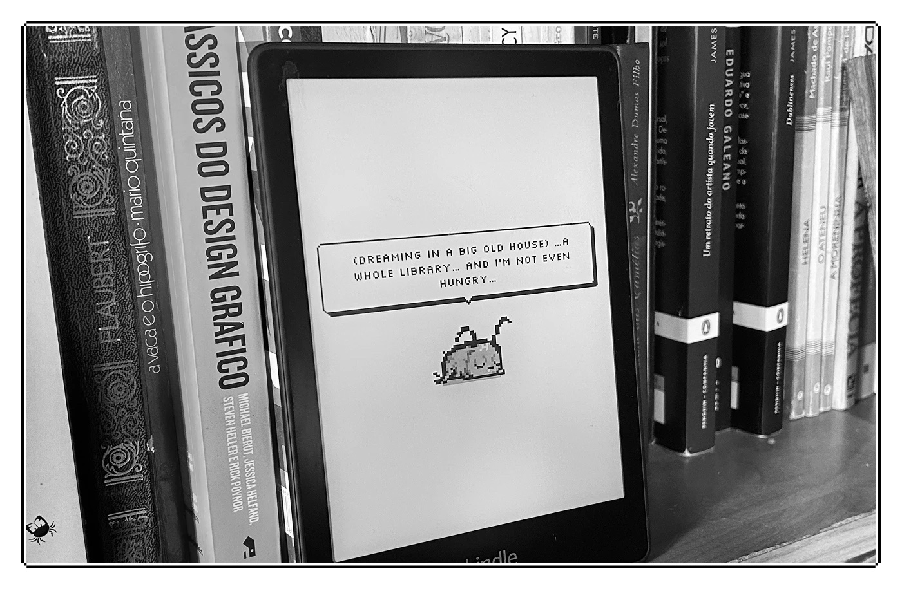
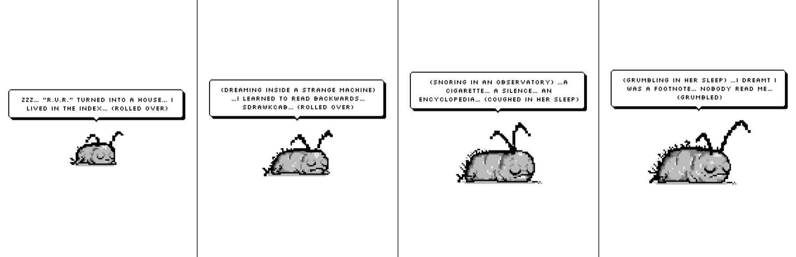

<picture>
  <source media="(prefers-color-scheme: dark)" srcset="media/hero-light.png">
  <source media="(prefers-color-scheme: light)" srcset="media/hero-dark.png">
  
</picture>

# Traça (Silverfish)

**Mora no seu leitor digital. Come o que você lê. Julga o seu gosto.**

*In English: [README.md](README.md).*

A Traça nasce de um ovo depois das suas primeiras páginas. Ela só come páginas lidas de verdade, cresce em quatro fases e, aos poucos, vira o que você lê. Quem lê ficção científica cria uma futurista desconfiada. Quem lê sátira cria uma crítica que revira os olhos para qualquer prefácio.

Ela funciona no seu leitor **sem IA e sem internet**. Tudo o que ela diz é montado no próprio aparelho a partir do que você lê, e a sua leitura nunca sai dele.

## O que ela faz

- **Come o que você lê.** Cada página lida por alguns segundos vira comida; folhear não conta. Se você para de ler, ela fica com fome, depois ranzinza, e acaba se escondendo na lombada até você voltar.
- **Cresce.** Ovo, ninfa, jovem, adulta, anciã. Depois de umas 2.000 páginas ela bota um ovo e começa uma nova geração, e a antiga entra para a **linhagem**.
- **Vira o que você lê.** Ela absorve o mundo dos seus livros: são 16 influências literárias, de ficção científica, sátira e horror a romance, mistério, poesia e filosofia. A personalidade também segue os seus hábitos: ler de madrugada faz uma notívaga, livro triste a deixa amarga, aventura a deixa corajosa.
- **Percebe o livro.** Conhece os personagens, as palavras, os lugares e o que acontece em cada capítulo. Comenta o capítulo, lembra o que os personagens disseram e faz uma resenha de cada livro que você termina.
- **Escreve um diário** dos seus dias de leitura e guarda um **caderno** com os seus destaques.
- **Sonha.** Ligue a tela de descanso dela e, quando o aparelho dormir, você vai vê-la dormindo, sonhando com o que você leu. Cada fase tem o seu desenho dormindo.
- **Conquistas e uma estante** com todos os livros que vocês terminaram juntos.
- **Português e inglês.** Ela segue o idioma do KOReader, ou você escolhe.

## Instalar

**Antes de começar:** você precisa do KOReader no seu aparelho. No Kindle, isso quer dizer um Kindle desbloqueado (jailbreak) com o KOReader instalado, que costuma ser aberto pelo KUAL. O guia do próprio KOReader explica como: [wiki do KOReader](https://github.com/koreader/koreader/wiki).

1. Baixe o `silverfish-v1.0.0.zip` em [Releases](../../releases) e descompacte. Dentro há uma pasta chamada `silverfish.koplugin`.
2. Conecte o aparelho ao computador e copie `silverfish.koplugin` para a pasta `plugins` do KOReader:
   - **Kindle:** `koreader/plugins/`
   - **Kobo:** `.adds/koreader/plugins/`
   - **Android:** `koreader/plugins/`, na memória interna
   - **Outros aparelhos:** a pasta `plugins` dentro da pasta do KOReader
3. Feche e abra o KOReader.

**Se você testou o beta** (uma pasta chamada `traca.koplugin`), apague essa pasta antes de copiar a nova, e nunca deixe as duas. A sua traça continua a mesma, porque o progresso dela fica em outro arquivo.

## Usar

- **Só leia.** O ovo choca depois de algumas páginas.
- **Para vê-la:** abra o menu de ferramentas e toque em **Traça**. Na tela de boas-vindas você também pode escolher abri-la quando o KOReader iniciar, ou segurando o dedo no canto superior direito.
- **Na tela dela** há um menu com o diário, o caderno, as conquistas e a linhagem.
- **Toque nela** para fazer carinho. **Segure o dedo nela** para as opções: tela de descanso ligada ou desligada, e idioma.
- **Opcional:** com o plugin Simple UI instalado, ela aparece num cartão na tela inicial.

## Tela de descanso

Quando o aparelho dorme, a Traça dorme junto e sonha com o que você leu: os personagens, as palavras, os lugares e os próprios livros. Cada fase tem a sua pose dormindo, e o ovo só descansa.

**Para ligar:**

1. Abra a Traça (menu de ferramentas → **Traça**).
2. Segure o dedo na traça.
3. Toque em **Tela de descanso: desligada**. Ela passa para **ligada**.

Para desligar, faça o mesmo. Enquanto está ligada, a Traça usa a tela de descanso do KOReader; quando você desliga, volta a tela de descanso que você tinha antes.

## Os seus dados

Tudo fica no seu aparelho, em `koreader/settings/traca.lua`: os títulos e autores dos livros que você leu, as páginas e os horários de leitura, o diário dela, algumas falas de personagens que ela guardou e o caminho do último livro que você abriu. A Traça nunca se conecta à internet e nunca manda nada para lugar nenhum.

## Atualizar

Troque a pasta `silverfish.koplugin` pela nova. A sua traça e o diário dela continuam.

## Desinstalar

1. Se a tela de descanso dela estiver ligada, desligue antes: segure o dedo na Traça e escolha **Tela de descanso: desligada**.
2. Apague `koreader/plugins/silverfish.koplugin`.
3. Para apagar também a Traça e o diário dela, apague o arquivo `koreader/settings/traca.lua` e a pasta `koreader/traca`.

## Compatibilidade

Testada no KOReader 2026.07.1, num Kindle Paperwhite 11. Deve funcionar em qualquer aparelho com KOReader (Kobo, PocketBook, Android), mas eles ainda não foram testados. Se você usar num deles, conte como foi em [Issues](../../issues).

**No Kindle:** abra o KOReader do jeito de sempre (pelo KUAL ou pelo atalho); não muda nada. A Traça só vê o que você lê no KOReader, não no leitor da Amazon, e a tela de descanso dela aparece quando o Kindle dorme com o KOReader aberto.

A Traça nunca trava a sua leitura. Se algo der errado, ela avisa que tropeçou e fica quieta até você reiniciar o KOReader. Nesse caso, abra uma issue e mande junto o arquivo `koreader/crash.log`.

## Limites conhecidos

- Em livros sem sumário, ela conta um capítulo a cada 25 páginas.
- Ela percebe o livro pelas palavras; não entende a história como uma pessoa. Às vezes um comentário sobre o capítulo erra o assunto.
