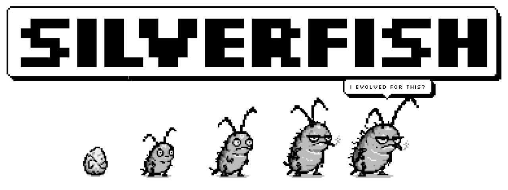
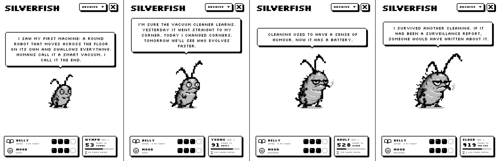
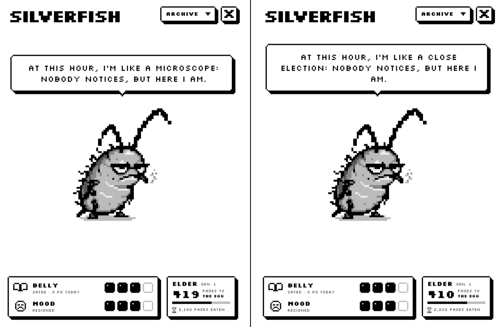
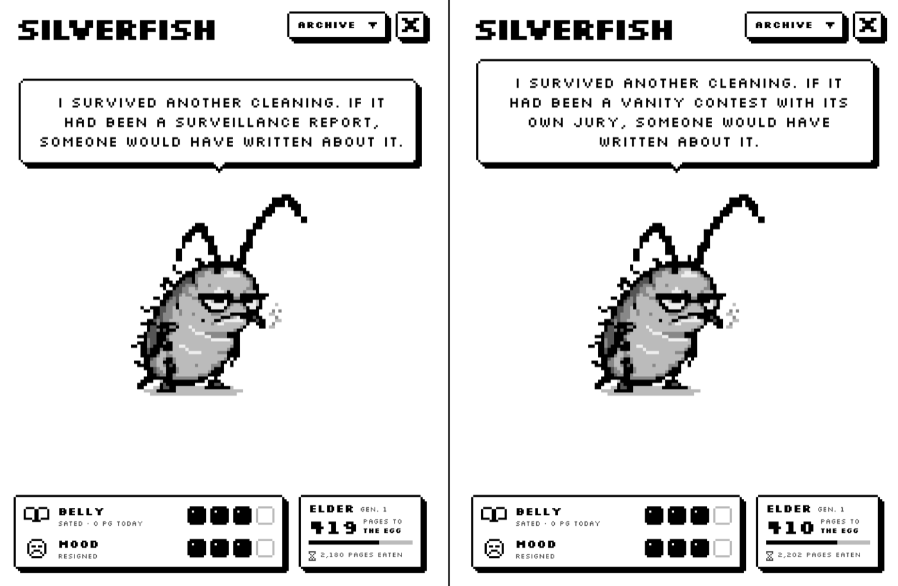
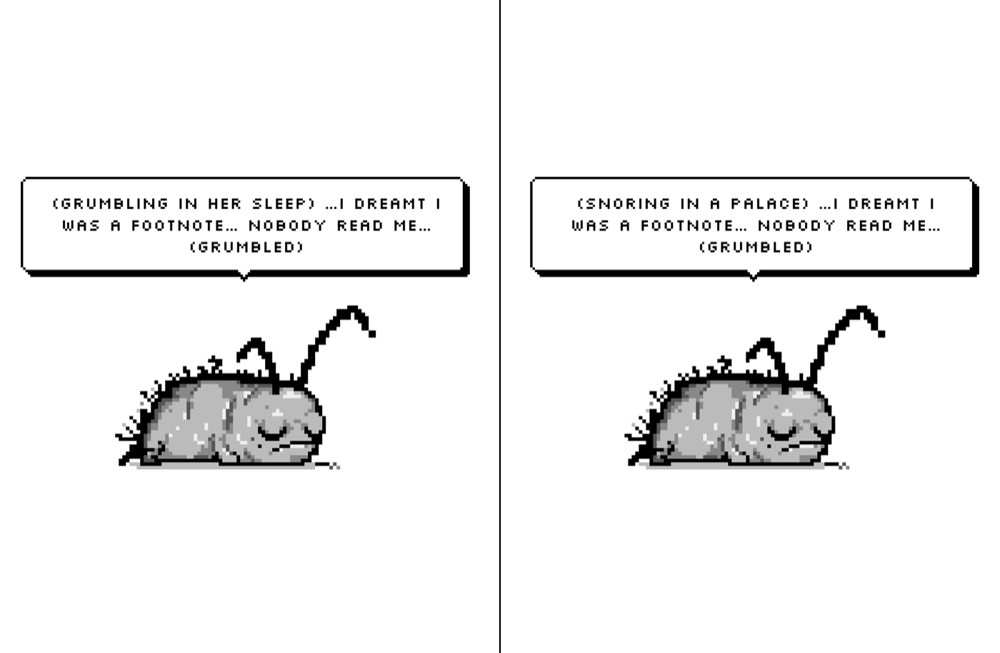

<picture>
  <source media="(prefers-color-scheme: dark)" srcset="media/hero-dark.png">
  <source media="(prefers-color-scheme: light)" srcset="media/hero-light.png">
  
</picture>

# Silverfish

**Lives in your e-reader. Eats what you read. Judges your taste.**

*Em português: [LEIAME.md](LEIAME.md).*

Silverfish hatches from an egg after your first pages. It feeds only on pages you actually read, grows through four stages, and slowly becomes what you read. A reader of science fiction raises a paranoid little futurist. A reader of satire raises a critic who rolls her eyes at prefaces.

It runs on your e-reader with **no AI and no internet**. Everything it says is put together on the device from what you read, and your reading never leaves the device.

## What it does

- **It eats what you read.** Every page you read for a few seconds becomes food. Skimming doesn't count. If you stop reading, it gets hungry, then grumpy, and eventually hides in the book's spine until you come back.
- **It grows up.** Egg, nymph, young, adult, elder. After about 2,000 pages it lays an egg and a new generation begins, and the old one goes into the family **lineage**.
- **It becomes what you read.** It picks up the world of your books: 16 literary influences, from sci-fi, satire and horror to romance, mystery, poetry and philosophy. Its personality also follows your habits: night reading makes a night owl, sad books make it bitter, adventures make it bold.
- **It notices the book.** It knows the characters, the words, the places and what happens in each chapter. It comments on the chapter, quotes what characters said, and reviews every book you finish.
- **It keeps a diary** of your reading days, and a **notebook** with your highlights.
- **It dreams.** Turn on its sleep screen, and when your e-reader sleeps you'll see it asleep, dreaming about what you read. Each stage has its own sleeping drawing.
- **Achievements and a bookshelf** with every book you finished together.
- **Portuguese and English.** It follows KOReader's language, or you can choose.

## Install

1. Download `silverfish-v1.0.0.zip` from [Releases](../../releases) and unzip it. Inside there is a folder called `silverfish.koplugin`.
2. Connect your e-reader to your computer and copy `silverfish.koplugin` into KOReader's `plugins` folder:
   - **Kindle:** `koreader/plugins/`
   - **Kobo:** `.adds/koreader/plugins/`
   - **Android:** `koreader/plugins/` in internal storage
   - **Other devices:** the `plugins` folder inside your KOReader folder
3. Restart KOReader.

**If you tested the beta** (a folder called `traca.koplugin`), delete that folder before copying the new one, and never keep both. Your silverfish survives the switch, because its progress lives in another file.

## Using it

- **Just read.** The egg hatches after a few pages.
- **To see it:** open the Tools menu and tap **Silverfish**. The welcome screen also lets you open it when KOReader starts, or with a long press in the top right corner.
- **Its screen** has a menu with its diary, your notebook, achievements and the lineage.
- **Tap it** to pet it. **Long-press it** for settings: sleep screen on/off, and language.
- **Optional:** with the Simple UI plugin installed, it shows up as a card on your home screen.

## Your data

Everything stays on your device, in `koreader/settings/traca.lua`: the titles and authors of the books you read, pages and reading times, its diary, a few lines from characters that it saved, and the path of the last book you opened. Silverfish never connects to the internet and never sends anything anywhere.

## Updating

Replace the `silverfish.koplugin` folder with the new one. Your silverfish and its diary stay.

## Uninstalling

1. If its sleep screen is on, turn it off first: long-press the silverfish and choose **Sleep screen: off**.
2. Delete `koreader/plugins/silverfish.koplugin`.
3. To erase the silverfish and its diary too, delete `koreader/settings/traca.lua` and the `koreader/traca` folder.

## Compatibility

Tested on KOReader 2026.07.1 on a Kindle Paperwhite 11. It should work on any device that runs KOReader (Kobo, PocketBook, Android), but those haven't been tested yet. If you run it on one of them, please say how it went in [Issues](../../issues).

Silverfish never blocks your reading. If something goes wrong, it says it tripped and stays quiet until you restart KOReader. In that case, please open an issue and attach `koreader/crash.log`.

## Known limits

- In books without a table of contents, it counts a chapter every 25 pages.
- It reads the book through its words; it doesn't understand the story like a person. Sometimes a comment about the chapter misses the point.

## License

- **Code:** [GPL-3.0](LICENSE).
- **The Silverfish character, its pixel art and its written lines** (the sprite files, the icons and the phrase banks in `traca_banco/`): [CC BY-NC-SA 4.0](LICENSE-ART.md). You can share and adapt them with credit and under the same license, but not for commercial use.
- Third-party data and the Silkscreen font keep their own licenses: see [CREDITS.md](CREDITS.md).

## Credits

Made by Matheus Oliveira, with Claude as a coding partner.
